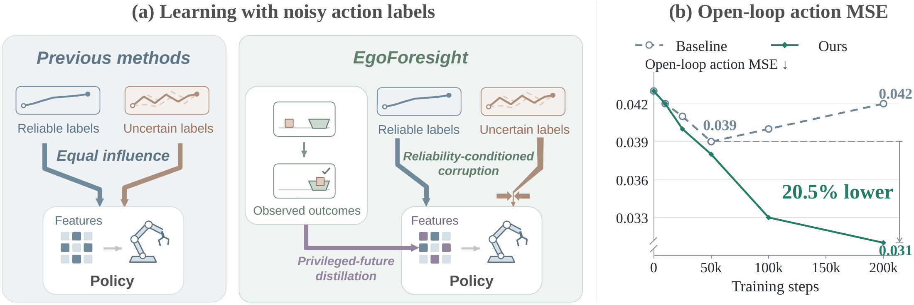
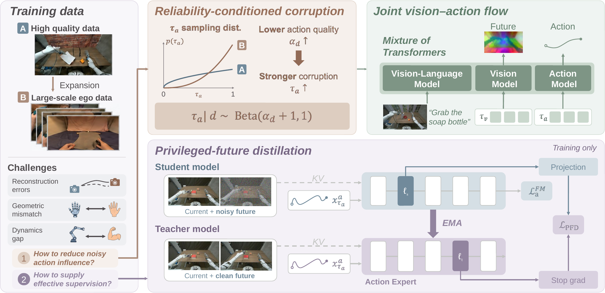
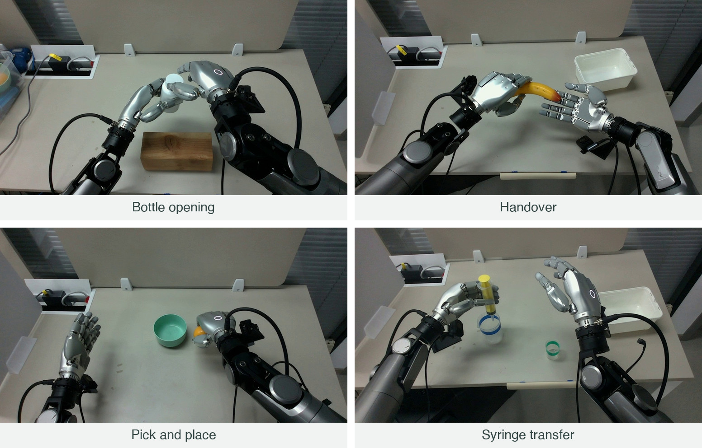

<!-- Copyright 2026 Chubin Zhang. SPDX-License-Identifier: MIT -->
<div align="center">

# EgoForesight

### Effectively Scaling Policy Learning<br>with Noisy Egocentric Actions

**Joint vision-action flow · Reliability-aware learning · Privileged-future distillation**

[Method](#method) · [Results](#results) · [Checkpoints](#checkpoints) · [Quick start](#quick-start) · [Documentation](#documentation)

</div>

<p align="center">
  
</p>

**Broad experience is valuable, even when its action labels are imperfect.** Robot demonstrations offer reliable supervision but are costly to collect. Egocentric videos expand task and environment coverage, while motion reconstruction and retargeting introduce noise. EgoForesight learns from both: it reduces the influence of unreliable action labels and uses demonstrated outcomes as complementary supervision.

This repository provides the **model, post-training, data preparation, evaluation dashboard, and R1Pro deployment** code. Pretraining data pipelines and private recordings are not included; checkpoints are listed [below](#checkpoints).

## Method

<p align="center">
  
</p>

1. **Reliability-conditioned corruption.** Allocate action supervision across noise levels according to each source's reliability, with reliability-weighted regression controlling its contribution.
2. **Privileged-future representation distillation.** An EMA teacher with privileged future information transfers deeper action representations to earlier student layers, adding outcome-informed structure beyond noisy action annotations.
3. **Joint vision-action flow.** Coupled transformer streams predict future visual representations and actions together, conditioned on a **Qwen3.5-4B** context encoder. Frozen **DINOv3** features provide visual prediction targets.

At inference, the policy uses the current observation, instruction, and robot state. See [model details](docs/model.md) for the retained MoT3 / Foresight Forcing implementation, action layout, and checkpoint interfaces.

## Results

### Scaling with noisy egocentric actions

At **30,000 hours of pretraining data**, compared with the paper's matched baseline:

| Real-world open-loop action error | RoboCasa few-shot success |
|:---:|:---:|
| **20.5% lower MSE** | **+8.1 percentage points** |

### RoboCasa: dexterous tabletop manipulation

**24 GR1 tabletop tasks**: 18 pick-and-place tasks and 6 articulated-object tasks, evaluated over **50 episodes per task**. This is the GR1 tabletop suite, **not RoboCasa365**.

| Post-training setting | Demonstrations / task | Pick-and-place | Articulated objects | Overall success |
|---|---:|---:|---:|---:|
| Full data | 1,000 | 71.9% | 80.0% | **73.9%** |
| Few-shot | 100 | 64.8% | 69.7% | **66.0%** |

### Real-world dexterous manipulation

<p align="center">
  
</p>

On a **Galaxea R1 Pro with Sharpa Wave hands**, EgoForesight achieves **63.8% mean full-task success** and a mean progress score of **84.8 / 100** across these four tasks, using **100 demonstrations and 20 evaluation trials per task**.

## Checkpoints

| Checkpoint | Hugging Face | Training configuration |
|---|---|---|
| **Base VLA** | [EgoForesight-pretrain](https://huggingface.co/LinShan/EgoForesight-pretrain) | Downstream initialization |
| **RoboCasa GR1** | [EgoForesight-RobocasaGR1](https://huggingface.co/LinShan/EgoForesight-RobocasaGR1) | [RoboCasa released](configs/posttrain/robocasa_released.yaml) |
| **RoboTwin** | [EgoForesight-RoboTwin](https://huggingface.co/LinShan/EgoForesight-RoboTwin) | [RoboTwin released · absolute EEF](configs/posttrain/robotwin_released.yaml) |

Set `PRETRAINED_CHECKPOINT` to a compatible **local `.pt` file**, not a repository URL. Keep the saved model configuration, normalization statistics, and any paired EMA sidecar with the checkpoint; see [checkpoint handling](docs/training.md#checkpoints).

## Quick start

Run commands from the **EgoForesight repository root**. This directory is self-contained and can be used as a standalone checkout.

### 1. Install

The training environment uses **Linux, Python 3.10, and CUDA GPUs**. See [environment setup](docs/environment.md) for dependency pins, external backbones, and separate data/simulator environments.

```bash
conda env create -f environment.yml
conda activate egofore
python -m pip install torch==2.8.0 torchvision==0.23.0 --index-url https://download.pytorch.org/whl/cu128
python -m pip install -r requirements/train.txt
python -m pip install --no-deps -e .
export PYTHONPATH="$PWD"
```

### 2. Prepare models and data

Obtain Qwen3.5-4B and DINOv3 under their respective terms, then prepare a supported dataset using the guides below. Use the base VLA checkpoint above to initialize post-training.

| Setup | Data preparation | Post-training recipes |
|---|---|---|
| **RoboCasa GR1 tabletop** | [Official data → aligned dataset](docs/data.md#robocasa-gr1-tabletop-24-tasks) | [Released checkpoint recipe](configs/posttrain/robocasa_released.yaml) |
| **RoboTwin 2.0** | [Official HDF5 → aligned dataset](docs/data.md#robotwin-20) | [Released checkpoint recipe](configs/posttrain/robotwin_released.yaml) · [Other variants](docs/training.md#choosing-a-recipe) |
| **R1Pro** | [Recording schema, calibration, and caches](docs/r1pro.md) | [R1Pro](configs/posttrain/r1pro.yaml) |

The RoboTwin links above use **non-mirrored** data; optional mirrored recipes and their requirements are covered in the [data guide](docs/data.md#optional-mirrors).

Clone the [official DINOv3 source](https://github.com/facebookresearch/dinov3) and obtain its ViT-B/16 weights using the [download commands](docs/environment.md#download-dinov3). `DINO_REPO` points to the source directory; `DINO_WEIGHTS` points to the separate `.pth` file.

For RoboCasa, set the following paths; [.env.example](.env.example) lists the other dataset and deployment variables:

```bash
export QWEN_MODEL=/absolute/path/to/Qwen3.5-4B
export DINO_REPO=/absolute/path/to/dinov3
export DINO_WEIGHTS=/absolute/path/to/dinov3_vitb16_weights.pth
export PRETRAINED_CHECKPOINT=/absolute/path/to/egofore_checkpoint.pt
export DATA_ROOT=/absolute/path/to/robocasa/aligned
```

### 3. Start post-training

A short, two-GPU launch to check your setup:

```bash
NUM_GPUS=2 BATCH_SIZE=1 GLOBAL_BATCH_SIZE=4 \
  bash scripts/posttrain.sh configs/posttrain/robocasa.yaml \
  --run_id robocasa_short --trainer.max_train_steps 3 \
  --trainer.num_warmup_steps 1 --trainer.save_interval 2 \
  --trainer.logging_frequency 1 --trainer.use_torch_compile false
```

Use a complete prepared dataset, or explicitly select a smaller data mixture; a single converted task does not satisfy the default multi-task recipe. For the released-checkpoint recipes and matching batch settings, see [released checkpoint training](docs/training.md#released-checkpoint-training). `DRY_RUN=1` prints the launch command without starting training.

The trainer includes **Accelerate / DeepSpeed ZeRO-2**, **hybrid Muon / AdamW**, distributed gradient/logging fixes, and model/EMA/native-resume checkpoint handling. See [training](docs/training.md) for multi-node launch, optimizer details, and resume; [AGENTS.md](AGENTS.md) collects developer workflows and short-run checks.

### 4. Evaluate and deploy

After configuring simulator environments and client paths in the [evaluation guide](docs/evaluation.md), launch the dashboard from the training environment:

```bash
python -m scripts.posttrain_dashboard.serve --directory results --port 8766
```

Open **http://127.0.0.1:8766** to select checkpoints, launch RoboTwin or RoboCasa evaluation jobs, and inspect logs, success rates, and rollout videos. `results` must be the parent of your experiment directories. Keep the dashboard local or use an SSH tunnel.

For a standalone benchmark policy server, see [serving](docs/evaluation.md#policy-server-without-the-dashboard). **R1Pro uses a separate robot protocol**; its recording format, model-side server, and deployment checks are described in the [R1Pro guide](docs/r1pro.md).

## Documentation

| Guide | Contents |
|---|---|
| [Model and method](docs/model.md) | Architecture, action representation, teacher behavior, and compatibility |
| [Environment](docs/environment.md) | Training, conversion, simulator dependencies, and pinned versions |
| [Data](docs/data.md) | Official RoboTwin / RoboCasa conversion, alignment, and normalization |
| [Training](docs/training.md) | Distributed execution, Muon, clipping, logging, EMA, and resume |
| [Evaluation](docs/evaluation.md) | Dashboard, benchmark clients, policy server, and videos |
| [R1Pro](docs/r1pro.md) | Real-robot data, calibrated caches, and deployment protocol |
| [Agent / contributor guide](AGENTS.md) | Repository map, development conventions, and verification workflow |

## Acknowledgments and license

Built on **StarVLA**, with components and integrations from Qwen, DINOv3, NVIDIA Isaac-GR00T, RoboTwin, RoboCasa, and the other projects credited in [NOTICE.md](NOTICE.md).

**EgoForesight additions and modifications: Chubin Zhang**, released under the [MIT License](LICENSE). Inherited code retains its original authorship and license terms; external models, datasets, simulators, and robot assets are not relicensed here.

## Citation

BibTeX placeholder — replace with the final paper citation when available.

```bibtex
@misc{egoforesight,
  title  = {EgoForesight: Effectively Scaling Policy Learning with Noisy Egocentric Actions},
  author = {TODO: Full author list},
  year   = {TODO},
  url    = {TODO: Paper URL}
}
```
